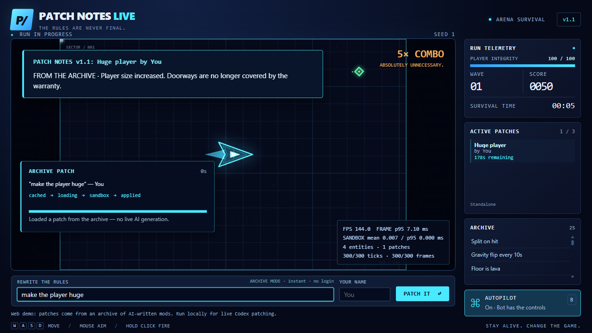
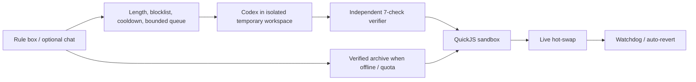

# Patch Notes Live

**Type a rule. Watch a real AI-written patch rewrite a game that is already running.** Patch Notes Live is a neon arena survival game whose rules are editable while you play: make enemies flee, turn the floor into lava, or become a ridiculously large spaceship. Locally, Codex writes the actual mod code, an independent verifier checks it, and an isolated QuickJS runtime hot-loads it without restarting the world. The web demo lets anyone try the same sandboxed mods instantly through a verified archive, with no login or local server. Twitch is an optional future input, not a requirement.



**[Play online — URL to be added after GitHub Pages is enabled](#play-online)**

## Play online

The Pages link is a placeholder until the owner creates the repository and enables Pages. The web build includes **25 verified archive patches**. Try **“make the player huge”** or **“enemies run away from you”**, or click a patch in **Archive**. The demo labels archive use honestly; it does not claim to generate new code in the browser.

Move with **WASD**, aim with the **mouse**, and hold **left click** to fire. **B** toggles autopilot; **R** restarts while keeping active patches. Rule inputs never trigger game shortcuts. Autopilot temporarily drives while the rule/name input is focused, with a visible chip; blur restores your chosen mode. The first-run card pauses simulation until dismissed. Offline patch applies grant three seconds of damage protection, shown by a shimmer. First-run help remembers dismissal when browser storage is available.

## Run locally

Node **24**, npm, and Codex access:

```sh
npm i
codex login
npm run dev
```

Or set `CODEX_API_KEY` in the environment / ignored root `.env` instead of CLI login. See [.env.example](.env.example); never put keys in the browser or commit them. `PATCH_CODEX_MODEL` optionally selects a Codex model; `PATCH_CODEX_REASONING=low` is the default.

Open **http://localhost:5173**. The command starts Vite plus the loopback WebSocket hub on port **8787** and builds trusted server/harness code first. Type a rule (200 characters maximum), optionally add your name, and press **Enter** or **Patch it**. The compile panel shows editing/testing progress and elapsed time. Typical measured generation is about a minute, so keep playing or use autopilot. Each connected client has a 20-second cooldown; the hub compiles one rule at a time and holds up to three waiting rules.

With the hub stopped, the game and archive still work. On quota exhaustion the hub tries a conservative archive match and explicitly says **“Codex is out of quota — loaded a patch from the archive.”** Unmatched requests show a distinct NO MATCH IN ARCHIVE panel with up to three clickable alternatives, which dismisses after six seconds. Rejected, failed and timed-out requests show their reason.

Useful flags: `?bot=1`, `?seed=42`, `?perf=1`, `?obs=1` (transparent arena/cursor hidden), `?server=off`, or `?server=ws://localhost:8787`. Patches last **180 seconds** by default (`?patchLifetime=180`, configurable 1–3600). Up to three remain active; the oldest expires on a fourth apply. Restart reruns their onStart hooks, preserving version/lifetime.

Existing CLI controls still work:

```sh
npm run patch -- "enemies run away from you" --apply
npm run patch:apply -- mods/samples/split-on-hit.js --author You
npm run patch:revert -- <patchId>
```

## How it works



The engine runs at a deterministic 60Hz with seeded randomness and plain intents/snapshots. The same engine and bot drive the browser and Node verifier. Codex only implements one rule in `mod.js`, using the small [typed mod API](packages/mod-api/api.d.ts). After generation, the pipeline independently verifies the source; the hub verifies it again before broadcasting it. Verification checks **load/schema/8KB size, stability on three seeds, instruction budget, runaway entities, bot survival, visible effect, and deterministic replay**. One diagnostic retry is allowed.

Each patch gets its own synchronous QuickJS WASM module, runtime, persistent state and budget. Mods send validated commands; they never receive live engine objects or DOM access. The overlay composes the sandbox with render-only effects. Its watchdog removes disabled/slow patches and restores their owned rule settings without rewinding movement, damage, score or time. Versions advance from v1.0 by 0.1 for every patch.

## Safety model

- Viewer text is untrusted, length-limited and blocklisted before display/use. It is rendered as text, never HTML or a shell command. This small blocklist is not comprehensive moderation.
- Runtime Codex works outside the repository in a fresh OS temporary workspace, with workspace-write sandbox, network disabled and approvals forbidden. Its template tells it to edit only `mod.js`; protected files are checked and unexpected files removed. Viewer text appears only as quoted data in REQUEST.md.
- QuickJS has a **16MB per-mod memory limit**, bounded stack, **64 interrupt polls per mod per tick**, frozen intrinsics, no host globals/network/timers, and validated engine commands. A single call over 50ms triggers emergency disable; three consecutive faults or ten total faults also disable it.
- The engine caps entities at **300**, validates numeric ranges, limits cosmetic bursts and bounded UI messages, and preserves deterministic game time/randomness. No mod executes with host `eval` or `new Function`.
- The live watchdog reverts auto-disabled mods or patches whose sandbox p95 exceeds 4ms over three seconds. The `time-bomb` sample documents the finite verifier’s limit: it passes 60 seconds, then faults after 70 and is caught live.
- The hub binds to loopback. It is a local development tool, not an authenticated public generation service. Do not expose it to the internet. Static hosting ships only the game, sandbox and preverified archive, with no credentials or Codex SDK.

## Measured benchmark

The 20-request benchmark was run with concurrency two. These are recorded local results, not guarantees for every new request:

| Metric                      | Recorded result                                        |
| --------------------------- | ------------------------------------------------------ |
| Game rules accepted         | **18/18**, all first try                               |
| Correct non-game rejections | **2/2**                                                |
| Median duration             | **~60 seconds** (62.85s)                               |
| p90 duration                | **~85 seconds** (82.81s combined; 84.57s second batch) |
| Retries                     | **0**                                                  |

[Benchmark implementation and validation](docs/step-7-script-validation.md). The visual-overhaul load run sustained **127–139 FPS** with **182–192 entities and three patches** on this machine; [raw timing data](docs/step-8.5-performance.json) includes the environment and measurement method.

## How Codex is used

Codex helped build the engine, sandbox, verifier, renderer and integration in this repository. More unusually, it is also part of the running product: the Node server uses the **Codex SDK** to start a thread in an isolated workspace, streams short human-readable editing/testing events, feeds independent verifier failures back for one repair attempt, and only publishes validated source. No model reasoning is dumped into the UI. `npm test` uses fake runners and never spends Codex quota. Its DOM regressions run a fresh headless Chrome/Chromium profile using the existing `ws` dependency (set `BROWSER_PATH` if the browser is outside a standard install location). The web demo transparently replays a verified archive of AI-written mods; the five handwritten seed examples are included too.

## Build and checks

```sh
npx tsc -b
npm test
npm run lint
npm run verify:archive
npm run build:web
npx vite preview
```

`build:web` verifies every archive entry and writes the self-contained static site to root **dist/**, using relative URLs (`base: './'`). Bare `npx vite preview` serves it at **http://localhost:4173** with archive mode as the default. No hub or AI credentials are required. This is server-free patching after the static assets are loaded, not a service-worker installation or a guarantee of a cold start without an internet connection. Files must be served over HTTP(S), rather than opened via `file://`.

The archive includes the five good samples, two generated CLI mods and all 18 available benchmark mods that passed a fresh verification. [Index](mods/archive/index.json) records names, original requests, funny notes and tags; [provenance](mods/archive/provenance.json) records their source paths. Matching uses normalized token overlap and synonyms, without a network call. `verify:archive` verifies the copied source and checks metadata consistency; it fails if anything is invalid or unindexed.

The [Pages workflow](.github/workflows/pages.yml) checks, builds and deploys on pushes to `main`, following [GitHub’s custom workflow setup](https://docs.github.com/en/pages/getting-started-with-github-pages/using-custom-workflows-with-github-pages). After creating the repository, enable **Settings → Pages → Source: GitHub Actions**. Add its URL above. No repository creation or push has been performed here.

For OBS, add a 1280×720 Browser source at `http://localhost:5173/?obs=1&bot=1`, 60fps. Keep the local dev process running; use Interact for controls or let autopilot play.

## Limitations

Generation needs local Codex authentication/quota and can take up to 150 seconds. The web demo has a finite archive and approximate matching; it cannot invent a new rule. Passing the verifier is bounded evidence across three seeds and 60 seconds, not proof of unlimited safety, fun, long-term survival or compatibility between every combination of patches. Several benchmark effects are conditional; a boss scheduled after 30 seconds will not appear immediately. Moon gravity is subtle. The watchdog is a second line of defense, not a substitute for isolation. Twitch, public hosting of live generation, comprehensive moderation, accounts, and sound are not implemented.

MIT licensed. [Architecture and scoped build plan](PLAN.md) · [Step 9 validation](docs/step-9-validation.md).

[Judge-flow regression fixes and preview evidence](docs/step-9-fixes-validation.md).
