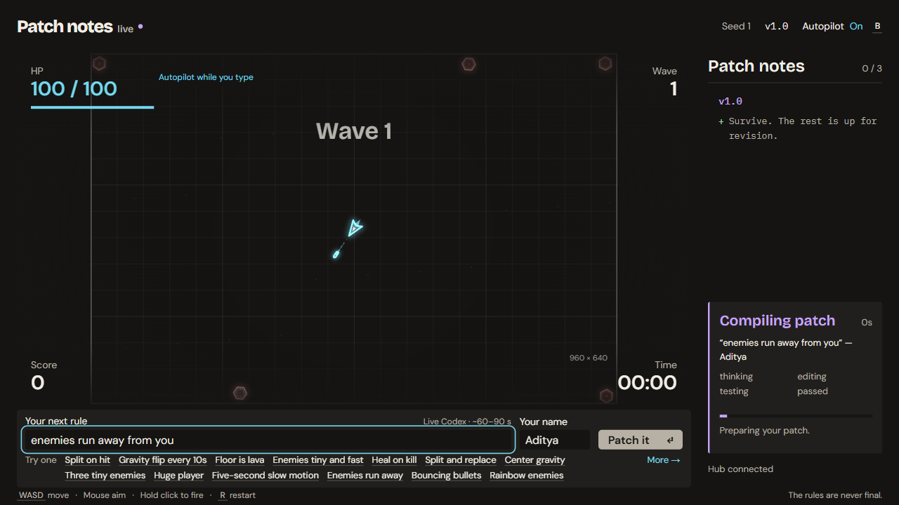
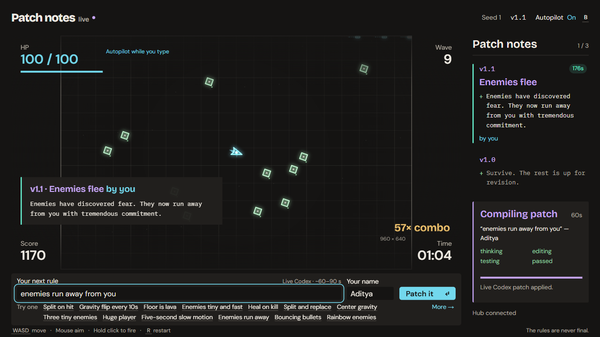
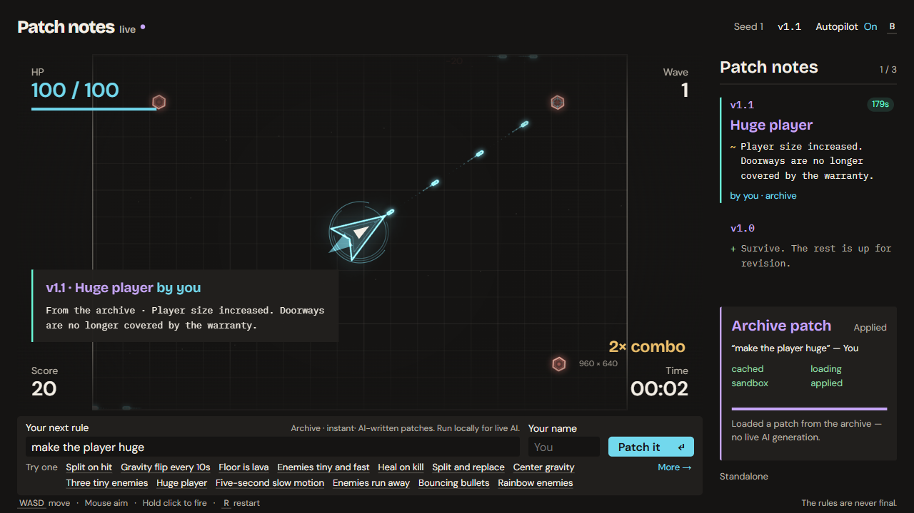
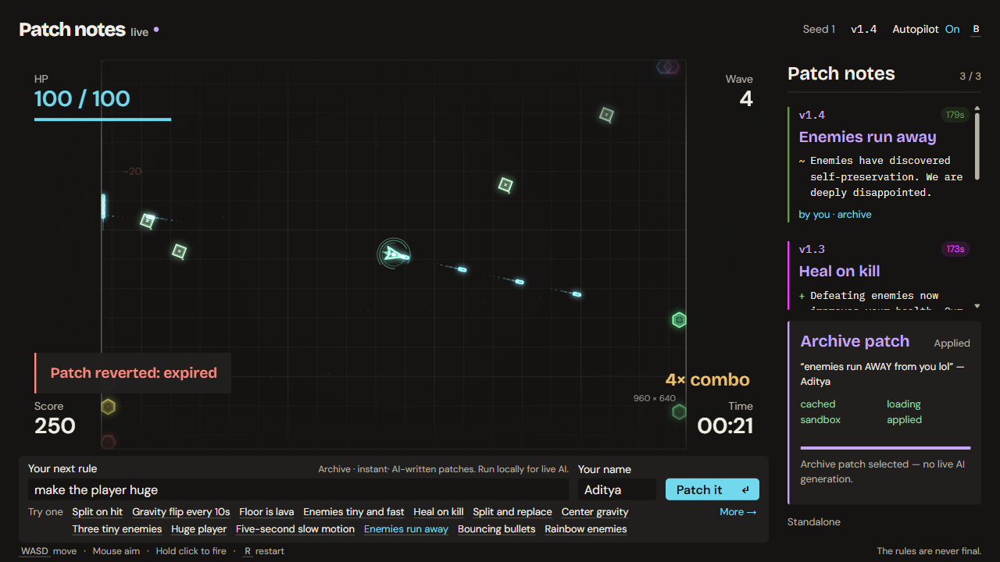
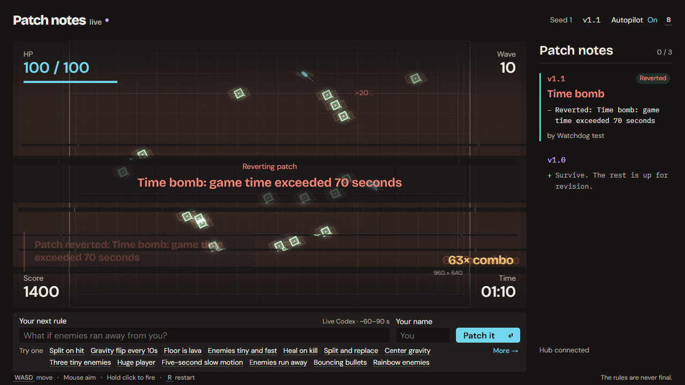
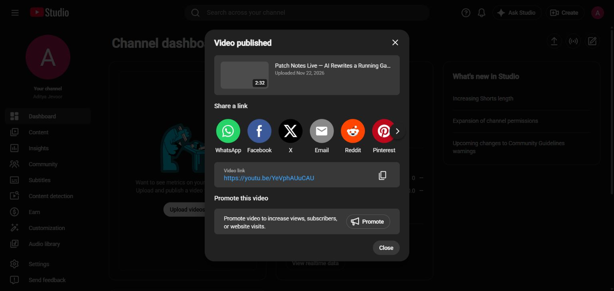

# Arbiter demo packet

Prepared November 22, 2026 for **Arbiter Hacks V1 — General Track**.
This packet is a draft; nothing has been sent to Devpost.

- [Play online](https://jozai193.github.io/patch-notes-live/)
- [Public source](https://github.com/jozai193/patch-notes-live)
- [Watch the unlisted YouTube demo](https://youtu.be/YeVphAUuCAU)
- [Download the MP4 and captions](https://github.com/jozai193/patch-notes-live/releases/tag/demo-v1)
- [Submission write-up](../../devpost-submission.md)
- [Narration script](narration.json), [timeline](timeline.json), [captions](captions.srt)

## Fresh checks

```text
npx tsc -b          exit 0
npm test           200 passed: engine 26, harness 28, mod-api 67, overlay 40, server 39
npm run lint       exit 0
npm run build:web  exit 0; archive 25/25 passed in 78.21 seconds
```

The first Linux deployment exposed a Play-transition scheduling overrun: 536.9ms
against the 450ms total limit. The animation is now 240ms (wipe) / 180ms
(reduced-motion crossfade), preserving the 450ms upper-bound regression. The full
root suite passed again locally, and the corrected
[GitHub Actions run](https://github.com/jozai193/patch-notes-live/actions/runs/45017710923)
passed its tests, build and Pages deployment. Historical November 10 measurements
remain in their original files.

## Real live patch

The rule **“enemies run away from you”** was submitted through the real browser
rule box to the local hub, using actual Codex generation. It produced **Enemies
flee**, independently verified at the pipeline and hub, then applied as v1.1
without reloading. The recorded apply arrived **59.865 seconds** after the queued
event. The browser capture returned after **64.087 seconds**, including a four-second
hold to show the result.

The captured source was independently verified again before packaging. All seven
checks passed. [Raw events and report](live-run.json) ·
[Unmodified generated source](live-flee.js.txt).

The video compresses part of the compile wait and labels that cut. It does not
substitute archived code for a live-generation claim.





## Public browser demo

The actual deployed Pages build was opened in Chromium. Pressing Play and entering
**“make the player huge”** applied the archived Huge player patch. The observed mode
was `Archive · instant`, the world reached tick 143, there were no page errors,
and none of the 23 requests targeted localhost or 127.0.0.1.
[Raw result](public-demo.json).



## Expiry and watchdog

The footage applies four real archive mods through the UI. The fourth expires the
oldest; this was not a fabricated server event.



The actual `time-bomb.js` sample passed hub verification, then faulted after game
time 70 seconds. The live watchdog reverted it at observed tick **4216 (70.267s)**,
displaying **“Time bomb: game time exceeded 70 seconds”**. The player remained
alive. [Raw observation](watchdog.json).



## Video production

The landscape master is 1920×1080, 30fps, approximately **2:31**. Actual browser
recordings show live generation, archive effects, fourth-patch expiry and the
watchdog. The verification card displays an excerpt of the actual generated mod
and its actual report. The final frame provides the public demo and code URLs.

The exported file is **151.210 seconds**, H.264/AAC, **19,780,166 bytes**. Measured
audio loudness is **−16.41 LUFS integrated**, with **−1.70dBTP true peak**. Captions
are burnt in and supplied separately as SRT. The script and edit decisions remain
editable, with original recordings/audio retained in the ignored local
`output/playwright/submission/` production directory.

YouTube Studio confirmed **Video published**, **Unlisted**, and **Checks complete.
No issues found.** The upload is on Aditya Jevoor's existing channel. Its public
viewing link is https://youtu.be/YeVphAUuCAU (the player rounds the duration to 2:32).
Publication proof is saved below.



Narration reuses the `DeepgramStreamingTTS` transport already in Jarvis. Apollo,
Thalia and Orion previews were generated; **Aura 2 Apollo** was selected for a
relaxed, conversational delivery. Jarvis source/configuration was not changed, and
its credentials were read only at runtime, never copied into this repository.

The narration contains 1,907 characters; three previews used 495 more. At the
published [Aura 2 pay-as-you-go rate](https://deepgram.com/pricing) of $0.030/1,000 characters, that is an estimated
**$0.0721 for synthesis**, plus a small transcription charge for caption timing.
This is a rate-based estimate, not a retrieved account invoice; the working cap
was $0.60. The music bed is an original locally synthesized chord progression.
Captions were aligned to the actual speech, then checked for names and terminology.

The invideo connector required reauthentication and its CLI was not signed in.
The reviewable edit is therefore preserved as local source recordings, a scene
timeline, edit decisions, audio and caption files; the MP4 was assembled using the
installed FFmpeg. No invideo generation credits were used.

## Remaining owner actions

The connected Devpost account did not list Arbiter registration when checked.
Register for the General Track and review/acknowledge the event rules before final
submission. Confirm the final video, write-up and team details, then approve the
actual Devpost submission. A draft packet or a published demo is not a submission
confirmation.
